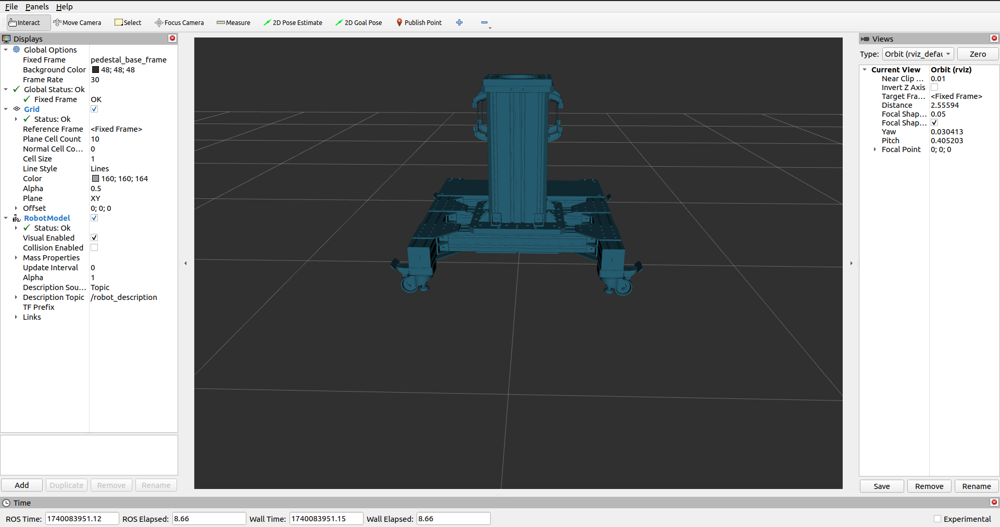
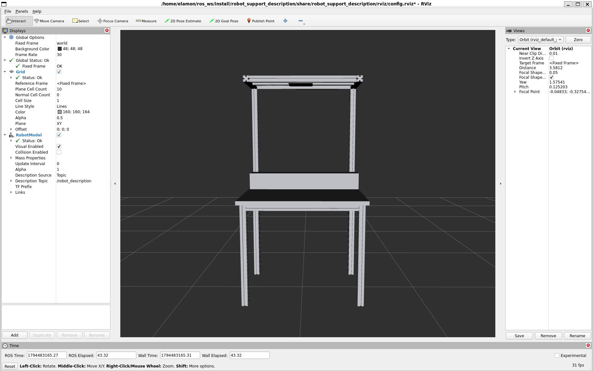

# robot_support_description
ROS2 description of robot support structures

## Overview

The `robot_support_description` package provides URDF descriptions for robot support structures (pedestals, tables, etc.) in the IDRA lab. Support structures available:
- **kuka_pedestal**: Pedestal for the KUKA iiwa 14, to be used with the [KUKA LBR repo](https://github.com/idra-lab/lbr_fri_ros2_stack/tree/pedestal) (pedestal branch);
- **ur_table**: Support table for UR robots to be used with the [UR descripiton repo](https://github.com/UniversalRobots/Universal_Robots_ROS2_Description);
- **doosan_pedestal**: Pedestal for the Doosan H2515 (to be added);

For each support structure, the xacro files define reference frames:
- **pedestal_base_frame / table_link:** Represents the base at ground level.
- **pedestal_top_frame / table_top:** Serves as the attachment point for robot bases.

A ROS 2 launch file processes these xacro files, merges their URDF outputs into a single robot description, and visualizes the model in RViz2.

## Usage (standalone)
To launch a support structure and view the model in `RViz2`, run:

```bash
ros2 launch robot_support_description display.launch.py pedestal_model:=kuka_pedestal
```



or for the UR table:

```bash
ros2 launch robot_support_description display.launch.py pedestal_model:=ur_table
```

